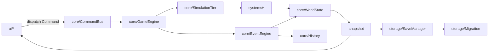

# 《王座与黄金》开发计划

**Throne & Gold — Development Plan v0.2**

- 编制日期：2026-11-19
- 修订日期：2026-11-19（v0.2：按仓库实现现状校准 §1/§5 目录与 §9 测试，新增 §5.2「实现偏差记录」与 §8.1「当前进度」）
- 依据文档：`design.md`（GDD v1.0，2107 行）
- 交付目标：16 周内产出可玩的单文件 MVP（`dist/index.html`）
- 人力假设：1 名开发者 + AI 结对开发
- 仓库根目录即项目根（原始清单中的 `throne-and-gold/` 为项目代号，对应本仓库 `personal_throne/`）

---

## 0. 文档职责

| 文档 | 回答的问题 | 变更频率 |
|---|---|---|
| `design.md` | 游戏**是什么**：玩法、规则、数值意图 | 低（策划变更时） |
| 本文件 | 游戏**怎么做**：架构、任务、排期、验收 | 高（每阶段更新） |
| `README.md` | 如何运行、如何构建 | 低 |

本计划不重复 GDD 的玩法定义。凡涉及"应该发生什么"的争议，以 `design.md` 为准；凡涉及"如何实现、先做哪一块"的争议，以本文件为准。

---

## 1. 工程基线

### 1.1 现状

- M0 工程基线已落地：Vite + `vite-plugin-singlefile`、TypeScript 严格模式、ESLint 架构约束（`core`/`systems` 禁依赖 UI 与存档层、禁 `Math.random` 与 `new Date()`）、Vitest、GitHub Actions。
- M1 模拟核心主体已落地：`src/core/` 8 个模块、`src/systems/` 14 个文件（6 个域）、14 条事件内容、存档信封与 IndexedDB 槽位、`pnpm sim` 命令行、5 个测试文件（33 条用例）。
- 当前处于「测试与性能收尾」阶段：100 年模拟可跑通、R1/R2/R3/R6 有回归用例，但性能基线、R8 内容校验用例与验收场景 A–F 的判定证据尚不完整（详见 §8.1、§9）。
- UI 仅 `src/main.ts` 引导页与 `src/ui/styles/base.css`；`src/ui/` 下的面板与地图组件尚未创建，M5 才开始。
- `release/index.html` 已是仓库内可下载的成品（当前 2,730 字节，占 1.5 MiB 预算约 0.17%）。

### 1.2 交付形态

| 项目 | 约定 |
|---|---|
| 发布物 | `dist/index.html` 单文件，JS/CSS/图片全部内联 |
| 运行方式 | 双击本地打开即可运行，**不依赖网络与本地服务器** |
| 浏览器 | Chrome / Edge 最近两个大版本，基准分辨率 1920×1080，最低 1366×768 |
| 存档 | 浏览器本地存储 + JSON 文件导入导出 |
| 包体预算 | 首屏 HTML ≤ 1.5 MB（gzip 前），加载 ≤ 1 s |

### 1.3 环境要求

- Node.js 22 LTS、pnpm 11（`packageManager: pnpm@11.28.5`）
- Git、VS Code（推荐插件：ESLint、Prettier、Vitest）
- 开发期另需 `tsx`（已列入 `devDependencies`，仅用于 `pnpm sim`，不进入产物）
- 无后端、无数据库、无云服务

---

## 2. 范围冻结（MVP）

范围一旦冻结，新增需求进入 `M6+ 待办`，不在 16 周内插入。

### 2.1 纳入范围

| 维度 | MVP 内容 | 来源 |
|---|---|---|
| 国家 | 2 个：银月王国（封建君主制）、港口自由同盟（商业共和国） | GDD 18.2 |
| 城市/地区 | 5 个（含首都、港口、矿区、农业区、边境镇） | GDD 18.2 |
| 组织 | 10 个（商会 4、佣兵团 2、教会 1、贵族家族 1、冒险者协会 1、秘密组织 1） | GDD 18.2 |
| 重要 NPC | 20 名（含 2 名统治者、4 名组织领袖、若干官员/商人/军官） | GDD 18.2 |
| 商品 | 粮食、铁矿、武器、奢侈品 | GDD 9.2 |
| 职业方向 | 商人、佣兵、政治人物（可交叉发展） | GDD 18.3 |
| 事件 | 组织 10、国家 8、宏观 6 | GDD 18.2 |
| 政策 | 财政（税率/支出）、商业（关税/贸易自由度）、军事（军费） | GDD 8.3 |
| 系统 | 时钟与快进、分层模拟、事件引擎、组织财务、区域市场、国家财政与政策、NPC 月度决策、人物与 D20 检定、历史记录、存档 | GDD 17.1 |
| 界面 | 顶栏 + 左人物 + 中地图 + 右情报 + 底行动/事件、四种地图图层、事件弹窗、组织面板、历史面板 | GDD 16 |

### 2.2 明确排除（M6+）

- 七国全量、完整世界地图与外交体系
- 战争深度模拟（MVP 只保留"战争风险事件 + 简化的战争结果"，不做战役级结算）
- 魔法经济、宗教体系、多世界包、模组接口
- 多人、联机、云存档
- 实时制、离线收益、签到
- 任意脚本化内容（事件只允许受限 DSL，禁止 `eval`）

### 2.3 MVP 成功判据

不是"模拟 100 年后生成一段精彩历史"，而是玩家能走完：

> 进入世界 → 选择身份 → 建立/加入组织 → 遭遇由经济政治自然产生的挑战 → 用不同策略应对 → 在世界状态中看到可解释的后果 → 达成目标后仍愿意继续 → 以另一身份重开同一世界。

对应 GDD 第二十四章，逐条映射见 §13。

---

## 3. 技术选型

| 领域 | 选择 | 理由 | 放弃的方案 |
|---|---|---|---|
| 语言 | TypeScript 5.x，`strict` + `noUncheckedIndexedAccess` | 世界状态字段多，类型是主要文档 | JS（重构风险高） |
| 构建 | Vite + `vite-plugin-singlefile` | 官方单文件方案，CSS/JS/资源内联，产物即发布物 | Webpack（配置重）、esbuild 手写（插件生态弱） |
| UI | 原生 DOM + 轻量组件类（`mount/update/dispose`） | 面板式界面，组件约 15 个；无虚拟 DOM 需求 | React/Vue：为单文件体积与长期依赖增加成本 |
| 地图 | SVG + 手写投影 | 区域数量少（5 城），SVG 便于命中测试与主题化 | Canvas（交互与缩放成本高）、地图库（体积） |
| 测试 | Vitest（node 环境 + 少量 jsdom） | 与 Vite 同源，快 | Jest（配置重） |
| 开发期 CLI | `tsx`（devDependency） | 直接执行 `scripts/sim.ts` 这类 TS 脚本，ESM 下零额外配置，且不参与打包 | ts-node（与 ESM/Vite 生态摩擦大）、先编译再运行（多一步产物） |
| 存档 | IndexedDB（主）+ localStorage（设置）+ 文件导出 | 快照体积可控（< 2 MB），IndexedDB 容量足够 | 纯 localStorage（5 MB 上限风险） |
| 架构风格 | 结构化对象 + 系统函数（非 ECS） | 实体 < 200，系统 14 个文件、6 个域；ECS 在此规模只增加间接层 | ECS |
| 状态管理 | `GameEngine` 单一 store + 订阅通知 | 权威状态唯一，UI 只读快照 | Redux 类库 |

**版本策略**：`package.json` 使用 caret 范围并在 `pnpm-lock.yaml` 锁定；升级依赖只在里程碑边界进行，且必须跑完整的确定性回归测试。

---

## 4. 架构总览

### 4.1 分层



### 4.2 五条铁律

1. **core 不依赖 UI**：`src/core/**` 与 `src/systems/**` 不得 import `ui/`、`storage/`、DOM API、`window`（ESLint `no-restricted-imports` 拦截）。
2. **单一写入口**：权威状态只能由 `GameEngine.dispatch()`（玩家命令）或系统结算函数修改；UI 不得直接改状态。
3. **随机唯一来源**：禁止 `Math.random()`；所有随机数来自 `Random.ts` 的命名流，可序列化、可复现。
4. **顺序确定**：所有实体遍历按稳定 ID 排序；结算按 `(日, 相位, 序号)` 三元组排序，禁止依赖 `Object.keys` 的插入顺序。
5. **时间唯一入口**：日期只能由 `GameClock` 推进；禁止直接赋值 `state.clock.day`。

### 4.3 数据流

```
玩家操作 → Command（带类型与参数）→ CommandBus 校验 → GameEngine 入队
  → advanceTo(targetDay)
      → 逐日/逐结算点推进 → 各系统按相位结算 → DomainEvent[]
      → EventEngine 抽样 → 新事件/后续事件
  → History 追加 + 快照版本号 +1 → 通知订阅者
  → UI 从快照重建视图（增量更新）
```

> **实现状态（v0.2）**：`GameEngine` 当前对外是 `dispatch()`、`advanceDays()`、`advanceTo()`、`hash()` 与只读 `state`；`snapshot()`、`subscribe()` 与中断通知属于 M5 接入 UI 时的工作，尚未实现。确定性校验目前用 `hash()` 代替快照版本号。

### 4.4 结算相位（同一天内的固定顺序）

| 相位 | 名称 | 内容 |
|---:|---|---|
| 0 | 行动 | 玩家/NPC 已提交行动的结算、移动、旅行到达 |
| 1 | 市场 | 产量、需求、价格、商路运输 |
| 2 | 组织 | 财务月结（月末）、规模与风险指标更新 |
| 3 | 国家 | 财政、政策压力、派系、外交 |
| 4 | 事件 | 风险抽样、事件结算、后续事件入队 |
| 5 | 收尾 | 生命周期变更、清理、历史摘要、快照 |

相位是**排序约束**而非"每相位每帧都算"：每个结算点只处理到期项（见 §7.1）。

---

## 5. 目录结构与模块职责

### 5.1 当前结构（v0.2 实测）

与 v0.1 计划的差异集中在内容装配、CLI/发布脚本与 `release/`，逐项理由见 §5.2。

```
personal_throne/                # 仓库根即项目根
│
├── index.html                  # HTML 入口（Vite 注入 /src/main.ts）
├── package.json                # 脚本与 devDependencies（含 tsx）
├── tsconfig.json               # strict + noUncheckedIndexedAccess + @/* 别名
├── vite.config.ts              # singlefile 打包与 vitest 配置
├── eslint.config.js            # 架构依赖方向 + 随机/时间禁令
│
├── src/
│   ├── main.ts                 # 引导页；M5 接 App.mount
│   │
│   ├── core/                   # 8 个模块，不依赖 UI/存档（已实现）
│   │   ├── GameEngine.ts
│   │   ├── WorldState.ts
│   │   ├── GameClock.ts
│   │   ├── CommandBus.ts
│   │   ├── EventEngine.ts
│   │   ├── Random.ts
│   │   ├── History.ts
│   │   └── SimulationTier.ts
│   │
│   ├── systems/                # 14 个文件，6 个域（已实现）
│   │   ├── character/          # Character / CharacterSystem / SkillCheck
│   │   ├── organization/       # Organization / OrganizationSystem / Finance / OrganizationRisk
│   │   ├── country/            # CountrySystem / PolicySystem（国家类型在 core/WorldState.ts）
│   │   ├── economy/            # MarketSystem / ProductionSystem / TradeSystem
│   │   ├── npc/                # DecisionSystem
│   │   └── military/           # WarSystem（当前仅月度军费结算）
│   │
│   ├── content/                # 静态内容（JSON 只在这里被 import）
│   │   ├── index.ts            # 唯一装配器：content / CONTENT_VERSION / eventsById
│   │   ├── races.json
│   │   ├── classes.json
│   │   ├── items.json
│   │   ├── goods.json          # 商品定义单列（v0.2 新增）
│   │   ├── organizations.json
│   │   ├── countries.json
│   │   ├── world.json          # 2 国 5 区 20 人
│   │   ├── balance.json
│   │   └── events/
│   │       ├── organization.json   # 4 条
│   │       ├── country.json        # 4 条
│   │       ├── economy.json        # 3 条
│   │       └── adventure.json      # 3 条
│   │
│   ├── storage/
│   │   ├── SaveManager.ts      # 信封、序列化/校验、IndexedDB 槽位、文件导出
│   │   └── Migration.ts        # SAVE_FORMAT / SAVE_FORMAT_VERSION / migrateSave
│   │
│   ├── ui/                     # M5 才建组件；当前只有 styles/base.css
│   │   └── styles/base.css
│   │
│   └── assets/
│
├── scripts/
│   ├── sim.ts                  # pnpm sim --years N --seed S [--check]（tsx 执行）
│   └── release.mjs             # dist → release，校验无外链与 ≤1,572,864 字节
│
├── tests/                      # 5 个测试文件（33 条用例）
│   ├── simulation.test.ts
│   ├── fastforward.test.ts
│   ├── organization.test.ts
│   ├── country.test.ts
│   ├── events.test.ts
│   └── helpers/index.ts        # makeWorld / makeEngine
│
├── release/
│   └── index.html              # 仓库内发布的成品单文件（已提交，CI 校验一致）
│
└── dist/
    └── index.html              # 构建缓存（.gitignore 忽略）
```

**相对 v0.1 计划的增量（6 处）**

| 增量 | 职责 | 原因 |
|---|---|---|
| `src/content/goods.json` | 商品定义（4 种：粮食、铁矿、武器、奢侈品）单列 | 商品同时被市场、生产、商路与组织 industry 引用；从 `world.json` 抽出后，调价与新增商品不必改地图文件。 |
| `src/content/index.ts` | 唯一 import JSON 的装配器，导出 `content: WorldContent`、`CONTENT_VERSION = '0.1.0'`、`eventsById` | 引擎只接收装配好的对象，不感知文件系统；事件在装配时按 id 排序，保证候选遍历顺序稳定。 |
| `scripts/sim.ts` | `pnpm sim --years N --seed S [--check]`，输出摘要、状态哈希与耗时 | M1 的验收入口；`--check` 复跑并比对哈希，直接对应 R1。 |
| `scripts/release.mjs` | 校验 `dist/index.html` 存在、非空、无外链、≤ 1,572,864 字节后复制为 `release/index.html` | 发布物必须在仓库内可直接下载；三道校验保证「单文件、零外链、不超预算」不会靠人工检查。 |
| `release/index.html` | 仓库内发布的成品单文件（当前 2,730 字节） | 构建目录 `dist/` 被 gitignore，发布物需要独立落点；CI 用 `git diff --exit-code -- release/index.html` 确认提交的产物与构建一致。 |
| `tests/helpers/index.ts` | `makeWorld(seed)` / `makeEngine(seed)` 测试夹具 | 5 个测试文件共用固定内容 + 固定种子，避免每个用例重复构造世界。 |

`src/content/balance.json`（v0.1 已列）职责不变：所有可调系数集中一处，批量模拟时可整文件替换做对照。

> 仍按原计划待增补：`src/ui/` 面板与地图组件、`src/assets/` 图片/图标、`tests/helpers` 中的快照哈希与会计不变量断言工具。当前仓库**没有** `systems/country/Country.ts`，国家类型直接定义在 `core/WorldState.ts`。

### 5.2 实现偏差记录

记录「计划写的」与「代码实际做的」之间的差异。**未验证的能力不写成已完成**；状态列只描述仓库里能读到的事实。

| # | 计划 / v0.1 写法 | 代码现状（v0.2） | 理由与影响 |
|---|---|---|---|
| 1 | 内容目录只有 `world.json` 承载商品与地图 | 商品拆到 `goods.json`；`world.json` 只留地图、初始人物与地区 | 见 §5.1 增量表；`world.json` 从 9 KB 级降到只含地理与人物，改商品不再碰地图 |
| 2 | 各模块自行 import JSON | 仅 `src/content/index.ts` import JSON，导出 `content`、`CONTENT_VERSION`、`eventsById` | 保持「引擎不认识文件系统」；事件按 id 排序后装配，遍历顺序确定 |
| 3 | 无开发期 CLI | `scripts/sim.ts` + `pnpm sim`（`--years` / `--seed` / `--check`） | M1 验收入口；`--check` 两次运行比哈希，是 R1 的手工版 |
| 4 | 发布 = `pnpm build` 产出 `dist/index.html` | `pnpm release` = build + `scripts/release.mjs`：存在性、无外链（`<script src>` / 外部 `<link href>` / `@import` / `url(http…)`）、≤ 1,572,864 字节，逐项通过才复制到 `release/index.html` | 单文件与体积预算是硬约束，交给脚本而不是 checklist；失败不产生半成品 |
| 5 | 发布物只在 `dist/` | `release/index.html` 进仓库并随阶段提交 | `dist/` 被 gitignore；仓库内的成品才可直接下载双击；CI 校验「提交的 release 与构建一致」 |
| 6 | `tsconfig`/`vite`/`vitest` 即可 | 额外 devDependency `tsx` | 只服务 `pnpm sim` 运行 TS CLI：ESM 下零配置、无需预编译产物、不进 bundle。选择它而非 ts-node 是为了避开与 Vite/Vitest 的 ESM 解析差异 |
| 7 | M1 命令集：`move` / `work` / `invest` / `createOrg` / `joinOrg` / `setStrategy` / `negotiate` / `lobby` / `advance` / `save` | 实际 8 条：`invest` / `recruit` / `set_strategy` / `take_loan` / `repay_debt` / `buy_asset` / `open_route` / `lobby` | 先打通「组织经营 + 商路 + 游说」闭环；移动、打工、创建组织等留到 M2/M4，届时再扩 `CommandBus` 联合类型 |
| 8 | `EventDef.text` 用 `titleKey` / `bodyKey`，且有 `choices` | 当前 `text: { title, body }` 直接内联中文；`choices` 未实现，玩家干预统一走 `Command` | 单语言 MVP 不需要 key 间接层；本地化时再统一切 key（见 §6 注）。事件选项的 UI 在 M5 补 |
| 9 | `GameEngine` 暴露 `snapshot()` / `subscribe()` | 当前只有 `dispatch()` / `advanceDays()` / `advanceTo()` / `hash()` 与只读 `state` | UI 未接入，订阅与快照没有消费者；先以 `hash()` 支撑确定性回归，M5 再加快照与通知 |
| 10 | `GameClock.nextInterrupt()` | 只实现 `nextBoundary()`；`ScheduledEvent` 有 `kind: 'interrupt'` 占位，但没有中断查询 API | 中断由「需要玩家决策」定义，等 M5 事件弹窗一起设计，避免先写一个没有调用方的接口 |
| 11 | `systems/country/Country.ts` | 无此文件；`Country` / `CountryDef` / `PolicyVector` 在 `core/WorldState.ts` | 国家实体字段少且被 core 直接引用，单列文件只会造成循环依赖风险；政策逻辑仍在 `PolicySystem.ts` |
| 12 | `WarSystem` 属 M6 | 文件已存在并接入引擎，但只做月度军费结算（`settleMonthlyMilitary`），没有战役、领土变更 | 军费是国民经济闭环的一部分，先按「军事开支」占位；深度战争仍按 M6 立项 |
| 13 | UI 组件在 M5 建 | `src/ui/` 仅 `styles/base.css`；`src/main.ts` 仍是引导页，文案写着「M0 工程基线已就绪」 | 阶段文案未随 M1 更新，属已知文案债；M5 接 `App` 时一并替换 |
| 14 | ESLint 禁 `Math.random()` 与 `Date.now()` | 规则拦截 `Math.random` 与 `new Date()`；`Date.now()` 尚无专门选择器 | `new Date()` 是主要的时间泄漏形态；`Date.now()` 由评审兜底，后续可补 `MemberExpression` 规则 |
| 15 | 里程碑 M2–M4 尚未开始 | 组织/经济/国家/人物/NPC 的系统文件与 14 条事件已随 M1 落地，但验收指标与场景测试未完成 | 代码骨架先行不等于里程碑完成；M2–M4 的退出标准仍按 §8 执行，本文档不提前打勾 |

### 5.3 模块职责与里程碑归属

| 文件 | 职责 | 关键导出 | 里程碑 |
|---|---|---|---|
| `index.html` | 唯一挂载点、字体与 meta、首屏骨架样式 | — | M0 完成 |
| `package.json` | 脚本：`dev` / `build` / `release` / `preview` / `typecheck` / `test` / `test:watch` / `sim` / `lint` / `format`；devDeps 含 `tsx` | — | M0 完成 |
| `tsconfig.json` | strict、`noUncheckedIndexedAccess`、`moduleResolution: bundler`、路径别名 `@/*` | — | M0 完成 |
| `vite.config.ts` | singlefile 插件、`assetsInlineLimit: 100_000_000`、`build.target: es2022`、vitest node 环境 | — | M0 完成 |
| `eslint.config.js` | core/systems 禁 import ui/storage；禁 `Math.random` 与 `new Date()` | — | M0 完成 |
| `src/main.ts` | 引导页（标题 + 版本）；M5 改为加载内容 → 校验 → 读档 → `App.mount` | — | M0 / M5 |
| `core/WorldState.ts` | 状态与内容类型、工厂、完整性校验、状态哈希 | `WorldState`, `WorldContent`, `createWorld()`, `validateWorld()`, `hashWorld()`, `monthKeyOf()` | M1 完成 |
| `core/GameClock.ts` | 360 天/年、相位枚举、结算点、下一边界、日期格式化 | `GameClock`, `DAYS_PER_YEAR`, `Phase`, `settlementPoints()`, `nextBoundary()` | M1 完成（`nextInterrupt()` 未实现） |
| `core/CommandBus.ts` | 8 条命令的联合类型、校验与结算 | `Command`, `applyCommand()`, `CommandResult` | M1 完成 |
| `core/GameEngine.ts` | 唯一写入口与时间推进；按日触发相位结算 | `GameEngine`（`dispatch` / `advanceDays` / `advanceTo` / `hash`） | M1 完成（无 `snapshot`/`subscribe`） |
| `core/Random.ts` | FNV-1a 种子派生、命名流、计数器、快照 | `Random`, `fnv1a64()`, `keyOf()` | M1 完成 |
| `core/EventEngine.ts` | 条件求值、λ 风险、互斥竞速、冷却、效果应用、后续事件 | `evaluate()`, `collectCandidates()`, `selectTriggered()`, `applyEvent()` | M1 完成 |
| `core/History.ts` | 追加式历史、查询、月度摘要 | `History`, `HistoryRecord`, `HistoryKind` | M1 完成 |
| `core/SimulationTier.ts` | L1/L2/L3 评分与升降层、国家聚合 | `Tier`, `computeTiers()`, `applyTiers()` | M1 完成（M2 继续校准） |
| `systems/character/Character.ts` | 人物查询、派生技能、财富转移 | `effectiveSkill()`, `transferWealth()` | M4 骨架 |
| `systems/character/CharacterSystem.ts` | 月度成长、年度老化、死亡与领袖继承 | `settleMonthlyCharacters()`, `settleYearlyCharacters()`, `handleDeath()` | M4 骨架 |
| `systems/character/SkillCheck.ts` | D20 检定、对抗检定 | `skillCheck()`, `opposedCheck()` | M4 骨架 |
| `systems/organization/Organization.ts` | 股权、控股、继承顺序、估值 | `majorityHolder()`, `successionOrder()`, `valuation()` | M2 骨架 |
| `systems/organization/Finance.ts` | 月度损益、权益与会计恒等式 | `settleMonthlyFinance()`, `equityOf()` | M2 骨架 |
| `systems/organization/OrganizationRisk.ts` | 冲突/资金/规模的风险增量 | `settleMonthlyRisk()` | M2 骨架 |
| `systems/organization/OrganizationSystem.ts` | 月度编排：财务 → 风险 → 生命周期 | `monthlyOrganizationSettlement()` | M2 骨架 |
| `systems/country/CountrySystem.ts` | 月度预算、债务、稳定性聚合 | `settleMonthlyCountry()` | M3 骨架 |
| `systems/country/PolicySystem.ts` | 政策压力、提案、政体差异 | `evaluatePolicyPressure()`, `runPolicyRound()`, `capitalWeight()` | M3 骨架 |
| `systems/economy/MarketSystem.ts` | 地区×商品价格与库存 | `settleMonthlyMarket()`, `priceOf()` | M2 骨架 |
| `systems/economy/ProductionSystem.ts` | 投入产出、产能、效率 | `settleMonthlyProduction()` | M2 骨架 |
| `systems/economy/TradeSystem.ts` | 商路流量、运力、关税 | `settleMonthlyTrade()` | M2 骨架 |
| `systems/npc/DecisionSystem.ts` | 效用评分与月度决策 | `strategyUtility()`, `settleMonthlyDecisions()` | M3 骨架 |
| `systems/military/WarSystem.ts` | 月度军费结算；战争深度模拟未做 | `settleMonthlyMilitary()`, `totalArmySize()` | M6（占位） |
| `content/index.ts` | 唯一 JSON 装配器；事件按 id 排序 | `content`, `CONTENT_VERSION`, `eventsById` | M1 完成 |
| `content/*.json` | 静态内容；`world.json` 2 国 5 区 20 人，`goods.json` 4 商品 | — | M1 完成 |
| `content/events/*.json` | 14 条事件（组织 4 / 国家 4 / 经济 3 / 冒险 3） | — | M1 完成（M2–M4 继续扩） |
| `storage/SaveManager.ts` | 信封、序列化与校验、IndexedDB 槽位、文件导入导出 | `createEnvelope()`, `serializeSave()`, `parseSave()`, `readSlot()`, `writeSlot()`, `listSlots()`, `deleteSlot()`, `downloadSave()`, `readSaveFile()` | M1 基础完成 |
| `storage/Migration.ts` | 信封与世界状态迁移、错误类型 | `SAVE_FORMAT`, `SAVE_FORMAT_VERSION`, `SaveError`, `migrateSave()`, `migrateWorldState()` | M1 完成（仅 v1） |
| `scripts/sim.ts` | 无 UI 快进、摘要、耗时、`--check` 复跑 | — | M1 完成 |
| `scripts/release.mjs` | 发布校验（存在/无外链/体积）并复制 | — | M0 完成 |
| `release/index.html` | 仓库内成品单文件 | — | 每阶段更新 |
| `tests/helpers/index.ts` | 固定内容 + 固定种子的测试夹具 | `makeWorld()`, `makeEngine()` | M1 完成 |
| `ui/App.ts` 等 | 布局、面板、SVG 地图、事件弹窗（**尚未创建**） | — | M5 |

**依赖方向**：`ui → core, storage`；`core → systems, content`；`systems → core（类型）, content`；`content` 不依赖任何代码。任何反向依赖由 ESLint `no-restricted-imports` 拦截。

---

## 6. 核心数据模型（草案）

类型定义分散在各自模块，`WorldState.ts` 只做聚合与校验。以下结构已按 v0.2 代码校准（以 `src/core/WorldState.ts` 为准）。

```ts
// core/WorldState.ts
interface WorldState {
  meta: { schemaVersion; contentVersion; seed; createdAt; worldId };
  clock: { day: number };                   // day 从 1 开始
  playerId: CharacterId;
  characters: Record<CharacterId, Character>;
  organizations: Record<OrgId, Organization>;
  countries: Record<CountryId, Country>;
  regions: Record<RegionId, Region>;
  markets: Record<MarketKey, Market>;       // `${regionId}:${goodId}`
  contracts: Record<ContractId, Contract>;
  relations: Relation[];                    // 有向边
  armies: Record<ArmyId, Army>;
  tiers: Record<EntityId, 1 | 2 | 3>;
  pendingEvents: ScheduledEvent[];          // 按 (day, phase, seq) 稳定排序
  rngCounters: Record<string, number>;
  cooldowns: Record<string, number>;        // `${eventId}@${entityId}` → 解禁日
  history: HistoryRecord[];
  scheduleSeq: number;                      // 调度序号，只增不减
}
```

```ts
interface Organization {
  id: OrgId; name: string; type: OrgType; industry: GoodId | 'service';
  foundedDay: number; homeRegionId: RegionId;
  scale: number;                     // 综合规模 0–100+
  cash: number; assets: number; liabilities: number;
  members: number; payrollMonthly: number;
  leadership: { leaderId: CharacterId; legitimacy: number };  // 0–1
  conflict: number; governance: number; efficiency: number;   // 0–1
  strategy: 'expand'|'steady'|'contract'|'pivot';
  lifecycle: 'founded'|'growing'|'stable'|'expanding'|'crisis'|'restructuring'|'shrinking'|'dissolved';
  shares: { characterId: CharacterId; share: number }[];      // 所有权；治理权由 leadership 表达
  lastMonthRevenue: number; lastMonthCost: number;            // 上月经营数据，供 UI 与再投资
}
```

```ts
interface Country {
  id: CountryId; name: string; polity: 'monarchy'|'republic';
  regionIds: RegionId[]; population: number;
  treasury: number; monthlyRevenue: number; monthlyExpense: number;
  debt: number; military: number;
  legitimacy: number; stability: number;   // 0–1，聚合值
  rulerId: CharacterId;
  policies: PolicyVector;                  // 税率/关税/军费/贸易自由度/监管强度
  diplomacy: Record<CountryId, number>;    // -100..100（M3 起使用）
}
```

```ts
interface Market {
  regionId: RegionId; goodId: GoodId;
  stock: number; production: number; demand: number;
  price: number; floor: number; ceiling: number;
  importCapacity: number; exportCapacity: number;
}
```

```ts
interface EventDef {
  id: string; domain: 'organization'|'country'|'economy'|'adventure';
  scope: 'organization'|'country'|'region'|'character';
  conditions?: Expr;                // 受限 DSL：all / any / not / {path,op,value}
  risk: { lambda0: number; terms: { path: string; coef: number }[] };
  exclusivity?: string;             // 同组事件互斥
  cooldownDays: number;
  weight?: number;
  effects: Effect[];                // add / mul / set / schedule
  text: { title: string; body: string };   // 当前内联中文，非 i18n key
}
```

**约定**

- 所有金额为整数"铜币"，避免浮点误差；比率用 0–1 浮点。
- 所有 0–1 的抽象指标（合法性、冲突、治理）在内部统一为 0–1，展示层再乘 100。
- 所有 ID 为稳定字符串（`org_blackcrow`），不使用自增数字，便于跨层与存档迁移。
- 时间统一存 `day`（整数），派生 `year/month/dayOfMonth` 只读计算。
- **与计划的差异**：`EventDef` 不再用 `titleKey/bodyKey`，也没有 `choices`；事件选项属于 M5 的 UI 工作，玩家干预统一走 `Command`（见 §5.2 第 8 条）。

---

## 7. 关键机制设计

### 7.1 时间与结算

- 历法：1 年 = 12 月 × 30 天 = 360 天；`day=1` 表示 1 年 1 月 1 日。
- 队列项：`{ day, phase, seq, kind, refId }`；`seq` 为入队序号，保证同日同相位稳定排序。
- 月结：每月第 30 天相位 2；季结：3/6/9/12 月末相位 3；年结：12 月 30 日相位 5。
- 倍速（1/7/30×）只影响**渲染节奏**，不改变结算语义：一次 `advanceTo` 与多次 `advanceTo` 结果必须一致。
- 中断：`nextInterrupt()` 返回"需要玩家决策"的最近节点（事件选项、合同到期、威胁生命、快进设置）。中断不消耗时间。

### 7.2 随机与可复现

- 算法：PCG32（32 位状态，易序列化，质量足够）。
- 派生键：`rngKey = ${stream}:${entityId}:${periodKey}`，`periodKey` 为结算点（如 `m120`）。
- 同一键多次取数时，用 `rngCounters[key]` 自增，保证"同一结算点内第 n 次抽样"稳定。
- 世界种子为字符串（如 `"T&G-2026-0001"`），`hashSeed()` 转为 64 位初始状态。
- **禁止**：`Math.random()`、`Date.now()` 参与模拟、`crypto.randomUUID()` 生成实体 ID（ID 由内容或确定性序列生成）。
- 验收：同种子 + 同命令序列，逐月与一次快进的最终状态哈希必须相同（测试 F）。

### 7.3 事件引擎

1. **加载期**：`content/index.ts` import JSON → TypeScript 在编译期按 `EventDef` 校验形状 → `validateWorld()` 在运行时校验引用（事件效果指向的组织/地区/人物必须存在）→ 失败则测试或构建报错。**说明**：未引入 JSON Schema 校验库，"编译条件为闭包树"也未实现，条件在每个结算点按 `Expr` 直接求值（内容量级下开销可忽略，见 §5.2 第 2、8 条）。
2. **风险计算**：`λ = λ0 × exp(Σ βᵢ·xᵢ)`，`xᵢ` 为归一化状态变量（0–1 或 z-score 后 clamp）。
3. **抽样**：对区间 `Δt`，`P = 1 − exp(−λ·Δt)`；同一 `exclusivity` 组内用指数竞速：`t_i = −ln(U_i)/λ_i`，取最小 `t_i` 且 `t_i ≤ Δt` 者发生，其余进入冷却。
4. **条件**：事件发生前必须通过 `conditions`（避免"高风险但条件不满足"仍被抽中）。
5. **效果**：只允许 `add` / `mul` / `set` / `schedule` 四类；每个效果写一条 `HistoryRecord`，`causeEventId` 指回触发事件，保证可追溯。
6. **后续事件**：`schedule` 效果写入 `pendingEvents`，`seq` 由 `scheduleSeq` 递增生成，形成事件链。
7. **玩家干预**：**尚未实现**。计划中的 `choices`（每项声明成本、成功率、可见/隐藏后果）随 M5 的事件弹窗一起做；在此之前玩家干预只能走 `CommandBus`，不直接改状态。

### 7.4 组织财务

- 月度损益：`利润 = 销售收入 − 采购成本 − 人工 − 运输 − 行政 − 利息 − 税费 − 损失`。
- 恒等式（每次月结后断言）：`资产 = 负债 + 所有者权益`；`现金变动 = 经营现金流 + 投资现金流 + 融资现金流`。
- 资产购买、贷款**不计入利润**，只改变结构。
- 违约流程：到期未付 → 宽限期（1 月）→ 重组（展期/债转股/出售资产）→ 清算；不得直接删除组织。
- 玩家三权分离：`shares` 决定分红与投票权，`positions` 决定治理权，`reputation/relations` 决定影响力；罢免通过 `OrganizationSystem` 的投票结算，不由 UI 直接改写。

### 7.5 市场与生产

- 价格：`P' = clamp(P × (1 + α·(D − S) / max(D, S, ε)), floor, ceiling)`；`α` 按商品配置（粮食 0.08、铁矿 0.12、武器 0.10、奢侈品 0.15，初值，待校准）。
- 生产：`产量 = min(劳动力上限, 原料上限/投入系数, 产能) × 效率 × 政策修正 × 安全修正`。
- 商路：运力、运费、时效、关税、战损概率；路由按最短路 + 容量约束分配。
- 不变量：区域内商品守恒（期初 + 产 + 入 − 出 − 消耗 = 期末），每次月结断言。
- 金币不强制全局守恒（税收/铸币/外部贸易是显式通道），但每笔注入必须记录 `cause`，便于审计数值膨胀。

### 7.6 国家与政策

- 预算：`收入 = 税基 × 税率 + 关税收入 + 国营收入`；`支出 = 行政 + 军费 + 公共支出 + 债务利息`；赤字进入债务。
- 稳定性：由财政压力、合法性、派系冲突、经济景气、战争疲劳加权，不做单一"稳定度"。
- 政策三阶段：压力（λ 计算）→ 提案（派系按利益打分选择方向）→ 决策（政体规则：君主制看统治者+贵族反对度；共和制看议会席位）。
- 政体变更：门槛极高，需连续 N 个季度满足条件 + 成功判定，变更后同步更新职位权限与政策选项。

### 7.7 NPC 决策

- 候选行动 8–12 个（投资、扩张、招募、结盟、竞选、举报、走私、休整）。
- `U(a) = Σ wᵢ·E[effectᵢ] − RiskCost(a) − ActionCost(a)`；性格权重来自 `traits`。
- 重要 NPC 每月决策一次；普通 NPC 用群体率（离职率、犯罪率、迁移率），不逐个规划。
- 决策记录写入 History（只记重要 NPC），供"世界观察"与调试回溯。

### 7.8 分层模拟

- 分层评分：`attention = w1·距离 + w2·关系强度 + w3·资产规模 + w4·玩家关注标记`；超过阈值升层，低于阈值降层。
- 降层时聚合：组织财务折算为区域行业总量，人物折算为群体统计；**保留 ID 与关键历史**，升层时按聚合值展开，不得凭空生成与历史矛盾的细节。
- 一致性约束（GDD 4.3）：唯一权威财政、资产不重复、ID 跨层一致、已发生事件不可撤销。

### 7.9 存档、迁移与回放

**已实现（v0.2，代码见 `src/storage/`）**

- 信封：`SaveEnvelope = { format: 'throne-and-gold-save', formatVersion, schemaVersion, contentVersion, savedAt, seed, day, hash, state }`；`formatVersion` 当前为 `1`（`SAVE_FORMAT_VERSION`），与状态自己的 `SCHEMA_VERSION = 1` 分开演进。
- 写入：`createEnvelope(state, savedAt)` → `serializeSave()`；读入：`parseSave(text)` 依次做 JSON 解析 → `migrateSave()`（拒绝非对象、未知版本、更高版本、缺 `schemaVersion`）→ `validateWorld()` → `hashWorld()` 与信封 `hash` 比对，任何一步失败抛 `SaveError`（`name = 'SaveError'`）。
- 槽位：IndexedDB `throne-and-gold` / store `saves` / keyPath `slot`；API `writeSlot(slot, state, label, savedAt)`、`readSlot(slot)`、`listSlots()`（按 `savedAt` 倒序）、`deleteSlot(slot)`、`storageAvailable()`。自动存档键名为 `AUTO_SLOT = 'auto'`，**滚动 3 槽尚未实现**（只有 `auto` 约定）。
- 导入导出：`downloadSave(state, filename = 'throne-and-gold-save.json')` 与 `readSaveFile(file)`；文件名不是计划里的 `.tg.json`。
- 迁移：`migrateSave(raw, savedAt)` 升级信封，`migrateWorldState(raw)` 升级状态；当前两者都是"版本相等直返"，否则抛「缺少 vN → vM 的迁移步骤」——**没有真实迁移链，也没有旧版本样本夹具**（见 §9.2 R8 补充项）。

**规划中（未实现）**

- 回放：`seed + 命令日志` 重建世界、回放哈希校验。当前只有 `engine.hash()` 与 `pnpm sim --check` 的"同参数复跑比哈希"，没有命令日志落盘。
- 压缩与分片：存档未压缩；大世界写入耗时未测（§9.3 预算待验证）。

### 7.10 界面

- 布局：顶栏（日期/倍速/身份/财富/通知）+ 左（人物）+ 中（地图）+ 右（情报）+ 底（行动/事件卡）。
- 组件契约：`mount(el)`、`update(snapshot)`、`dispose()`；只读快照，不持有可写引用。
- 地图：SVG 分层（地形、边界、城市、商路、军队），四图层切换；缩放用 `viewBox`。
- 事件弹窗：背景、触发原因（引用历史）、已知情报、选项、成本、风险、隐藏后果。
- 通知：三级（打断/横幅/日志），玩家可在设置中调整优先级。
- 性能：单次 `update` < 16 ms；地图重绘只在图层或选择变化时发生。

---

## 8. 里程碑与排期

以启动周为 W1，共 16 周。每周 5 个工作日，按 1 人 + AI 结对估算。

### 8.1 当前进度（v0.2 实测）

| 里程碑 | 状态 | 证据（仓库内可核对） |
|---|---|---|
| M0 工程基线 | ✅ 完成 | `pnpm build` / `pnpm release` 脚本齐备；`release/index.html` 已入仓，2,730 字节（预算占用 0.17%）；CI 四步全配 |
| M1 模拟核心 | ✅ 完成 | 8 个 core 模块、14 个 systems 文件、内容装配、存档、`pnpm sim`、34 个用例；100 年模拟实测 1.3 s（预算 2 s），同种子哈希稳定；R8 由内容审计与 `validateWorld` 覆盖；证据见 §8.2 |
| M2 组织与经济 | ✅ 完成 | 生命周期四态与清算、契约（供货/运输/贷款/雇佣）、市场份额竞争、在途货运与关税、四类风险系数表、组织事件 10 条；验收 B/D 已断言，100 年破产率 22.2–31.6%、分裂率 5.6–10.5%；证据见 §8.3 |
| M3 国家与政策 | ✅ 完成 | 政策三阶段 + 传导经济 + 政体不变式 + 国家事件 10 条 + 内阁决策；验收 C 已断言；100 年政策变更 17/18/25 次、均价偏离 12.8–16.3%、20/20 市场在 70–140%；65 用例；证据见 §8.6 |
| M4 角色与叙事 | ✅ 完成（M4.1–M4.6） | 人物档案、人口学、存档 v4 迁移、开局创建（6 背景 × 3 天赋）、关系网（五类有向关系 + 年度回归）、生涯阶梯（3 职业 × 4 级，财富+技能+公职晋升、破产降级、转行命令）已落地；存档 v5；100 年 demo 存活 45 人、破产率 17.9%、价格偏离 14.3%；事件链与抉择（`choices` + `choose` + 超时自动处理）已落地；验收报告见 `docs/acceptance.md`；证据见 §8.7–§8.12 |
| M5 整合与校准 | 🟡 薄 UI 可用 | `src/ui/` 14 个文件（玩家卡 + 地图/人物/组织/国家/事件/历史 + 时间控制 + 存档 + 人物创建），`release/index.html` 197 KB 单文件可离线游玩；完整美术、教程与校准未做 |
| M6 战争与扩展 | ⬜ 占位 | `WarSystem` 仅月度军费结算，无战役与领土变更 |

### 8.2 M1 收尾修复（2026-11-19）

审计（内容只读审计 + 逐月探针）后修掉的问题，按影响排序：

| 问题 | 根因 | 修法 |
|---|---|---|
| 100 年模拟 130 s，超预算 65 倍 | `GameEngine.settlePhase` 每个相位都调 `syncCounters()`，而 `Random.countersOf()` 复制全量计数器表 → O(n²) | 只在 `advanceDays`/`advanceTo` 结束与 `dispatch` 失败分支同步；实测降到 1.3 s |
| 所有组织 2 年内现金归零 | `Finance` 把上月全量成本 `lastMonthCost` 当成"运输成本"再扣一次 | 新增 `Organization.lastMonthTransport`，贸易只登记、财务只扣一次 |
| 只要有一个月结余，粮价永久钉在下限 | 市场用 `stock + production` 作为当月供给参与竞价 | 供给 = 当月 `production`，`stock` 仅作缓冲库存 |
| 组织"卖出"超过市场需求的货，现金与国库无限膨胀 | 收入 = 产量 × 价格，与需求无关 | 同地区同行业按产量份额瓜分当月需求（`sellableUnits`）；留存现金超 12 个月工资转资产 |
| 国库长期盈余无限膨胀 | 只有税收流入，没有泄压阀 | 超 6 个月刚性开支的部分，一半用于公共工程（可选支出，不计入赤字判定） |
| 角色类事件永不触发 | `computeTiers` 不给人物分层，`?? 3` 被 `maxTier=2` 过滤 | 人物按"所在地区 / 所属组织"继承层级；新增回归用例 |
| 同盟地区与组织在第 90 天后整体冻结 | 跨国地区需分数达标才升 L2，同盟地区恒 L3 | 2 跳内地区一律 L2，L1/L2 地区内的组织一律 L2 |
| 政变 / 分裂 / 战争恐慌事件永不触发 | 阈值高于内容初值，且无增长机制 | 政变 `conflict>0.3`、分裂 `>0.45`；战争恐慌改用 `debtRatio`（国家口径 = 债务/(国库+债务)） |
| `ev_country_aftermath` 脱离前置事件独立触发 | 无前置约束、λ0 过低 | 加 `stability<0.6` 条件、λ0 提至 0.01、效果改为扣国库 |

> 结论：**M1 之后进入"测试与性能收尾"，而不是直接宣布 M2–M4 完成**。M2–M4 的代码骨架先行为的是让 100 年模拟有足够多的耦合面，退出标准仍按下表执行。

### 8.3 M2 组织与经济（2026-11-19）

| 机制 | 实现 | 证据 |
|---|---|---|
| 生命周期 | `Lifecycle.ts`：active → crisis（宽限）→ restructuring（出售资产/裁员/展期）→ dissolved；清算顺序 债主 → 欠薪 → 股东，差额记 `shortfall` 并入历史 | `tests/economy-m2.test.ts`、验收 D |
| 契约 | `ContractSystem.ts`：供货 / 运输 / 贷款 / 雇佣，含到期日、违约金、抵押处置；新命令 `sign_contract`、`break_contract`、`restructure`、`sell_asset` | 验收 B、D |
| 竞争 | 同地区同行业按吸引力（价格/质量/商誉）分配 `marketShare`，份额和 = 1；NPC 组织可新进入 | 验收 B |
| 运输与关税 | 在途 `Shipment` + 运输延迟 + 3% 损耗 + 运力上限；跨国按目的地国 `tariffRate` 收关税入国库 | 验收 B |
| 风险 | 分裂 / 破产 / 腐败 / 骚乱四类只读 `balance.risk` 系数表，`hazard = λ0·exp(Σcoef·feature)` | `OrganizationRisk.ts` |
| 事件 | 组织事件 4 → 10 条（继承纠纷、挤兑、罢工、并购、走私被查、商路断绝等），经济事件 3 条 | 30 年三 seed 每条 ≥1 次 |
| 确定性与性能 | `Random` 改为 FNV-1a 32 + splitmix32（命名流不变）；100 年 1.42–1.73 s | `pnpm sim --check` |
| 存档 | `SCHEMA_VERSION` / `SAVE_FORMAT_VERSION` 升到 2，新增 v1 → v2 迁移（补齐契约、货运、份额、风险字段；跨版本迁移后丢弃旧哈希） | `tests/migration.test.ts` |

**已知问题**：同盟的 grain / iron 长期顶在价格上限（三 seed 价格偏离 120–128%），根因是"本地无生产 + 进口运力不足"，计划在 M3 用本地生产与运力解决，不靠调参掩盖。`release/index.html` 由 M1 的 2,730 字节增长到 145 KB（预算占用 9.2%）。`tests/simulation.test.ts` 的 100 年双跑用例超时从 5 s 放宽到 20 s（单次约 1.7 s，双跑必超 5 s，非逻辑改动）。

| 里程碑 | 周期 | 目标 | 退出标准 |
|---|---|---|---|
| M0 工程基线 | W1 | 可构建、可测试、可发布单文件 | `pnpm build` 产出可双击运行的 `dist/index.html`；`pnpm test` 跑通空测试 |
| M1 模拟核心 | W2–W4 | 无 UI 可稳定模拟简化世界 | 控制台可跑 100 年，状态哈希稳定；存档往返一致 |
| M2 组织与经济 | W5–W7 | 商会可创建、经营、竞争、破产 | 验收测试 B、D 通过；组织指标分布合理 |
| M3 国家与政策 | W8–W10 | 政策可自主变化并与经济联动 | 验收测试 C 通过；100 年模拟无政策抖动 |
| M4 角色与叙事 | W11–W13 | 完整人物生涯与事件链 | 验收测试 E 通过；一名角色可完成"商人→从政"路径 |
| M5 整合与校准 | W14–W16 | 完整 UI、性能达标、数值校准 | 验收测试 A、F 通过；包体与性能达标；可发布 |
| M6 战争与扩展 | W17+ | 战争、七国、魔法经济 | 单独立项，不在本计划承诺 |

> **M4 及以后的细化路线**见 [docs/roadmap-m4-plus.md](docs/roadmap-m4-plus.md)：M4 拆成 6 个子迭代并重新计价为 **36 人日**（原 15 人日不含世代更替/事件链/抉择/人物档案），M5 24 人日、M6 36 人日，合计 **96 + 6 缓冲 ≈ 21 周**；决策记录见该文件 §0.1，人物档案模型（六维 / 阵营九宫格 / 信仰 / 地点）见 §2.0.1。

### 8.4 薄 UI（2026-11-19）

`src/ui/` 12 个文件，纯原生 DOM + SVG，零依赖：

| 区域 | 文件 | 能力 |
|---|---|---|
| 布局与状态 | `App.ts` / `context.ts` | 顶栏（日期/玩家/现金/速度/哈希）、页签、toast、统一刷新 |
| 地图 | `MapView.ts` / `RegionPanel.ts` | 5 个地区 + 连线（标注行程天数）、键盘可达；点选后显示 4 商品价格/库存/需求与该地组织 |
| 人物 | `CharacterPanel.ts` | 玩家属性/技能/职位 + 其余 19 名 NPC 只读卡片 |
| 组织 | `OrganizationPanel.ts` | 现金/资产/负债/成员/士气·效率/冲突/合法性/治理 + 玩家控制组织的 7 类操作 |
| 国家 | `CountryPanel.ts` | 两国财政与五条政策滑块 + 游说入口 |
| 事件与历史 | `EventDialog.ts` / `HistoryPanel.ts` | 预兆弹窗（不剧透结局）+ 最近 50 条可筛选历史 |
| 时间与存档 | `App.ts` + `SaveManager` | 暂停 / 1× / 7× / 30× / 跳下一事件；自动槽位保存、读取、导出、导入 |

验证：`release/index.html` 单文件 145,259 字节（无 `<script src>`、无 `<link href>`），真 Edge `file://` 打开探针输出 `panels=6 | buttons=69 | svg=1 | errs=0`。
已知取舍：士气用 `efficiency` 表达；预兆弹窗只显示占位文案，结算后的历史记录才显示事件正文；存档只做一个自动槽位；"跳下一事件"严格推进到 `pendingEvents` 最早日期，但引擎在月末 Event 相位才触发。


### M0 工程基线（W1，5 人日）

**任务**

1. `package.json`：脚本 `dev/build/preview/test/test:watch/typecheck/lint/sim`；依赖仅 `vite`、`vite-plugin-singlefile`、`typescript`、`vitest`、`eslint`、`prettier`。
2. `tsconfig.json`：`strict`、`noUncheckedIndexedAccess`、`exactOptionalPropertyTypes`、路径别名。
3. `vite.config.ts`：singlefile 插件；`build.assetsInlineLimit: 100_000_000`；`build.cssCodeSplit: false`；产物名固定 `index.html`。
4. `index.html`：`#app` 挂载点 + 首屏 loading 骨架。
5. 目录骨架与 `.gitignore`（`node_modules/`、`dist/`、`.tmp/`）。
6. ESLint 规则：禁止 `ui → systems` 反向依赖、禁止 `Math.random`。
7. CI（GitHub Actions）：`pnpm install --frozen-lockfile && pnpm typecheck && pnpm test && pnpm build`，并检查产物大小。

**退出标准**：空项目可构建，产物能在 `file://` 下打开并显示"王座与黄金"标题；CI 绿。

### M1 模拟核心（W2–W4，15 人日）

**任务**

1. `WorldState.ts`：类型、`createWorld(content)`、`validateWorld()`（引用完整、金额非负、ID 唯一）。
2. `GameClock.ts`：日/月/年换算、结算队列、`nextBoundary()`、`nextInterrupt()`。
3. `Random.ts`：PCG32、`hashSeed`、命名流、计数器、快照。
4. `CommandBus.ts`：命令联合类型（`move`、`work`、`invest`、`createOrg`、`joinOrg`、`setStrategy`、`negotiate`、`lobby`、`advance`、`save`），校验器。
5. `GameEngine.ts`：`dispatch`、`advanceTo`、`snapshot`、`subscribe`；相位调度；错误隔离（单个系统异常不污染状态，事务式回滚）。
6. `EventEngine.ts`：加载/编译/校验、λ 计算、抽样、冷却、后续队列；先接 3 个示例事件验证管线。
7. `History.ts`：记录结构、索引、按月摘要。
8. `SaveManager.ts` + `Migration.ts`：快照序列化、槽位、v1 迁移空实现。
9. `content/world.json`：2 国 5 城的最小地理与初始实体（人物 20、组织 10 可先用占位数据）。
10. 测试：`fastforward.test.ts`（逐月 vs 快进等价）、状态哈希 golden test。

**退出标准**：Node 下 `pnpm sim --years 100 --seed X` 输出世界摘要与指标 JSON；两次运行哈希一致；存档→读档→再模拟 10 年与不中断模拟结果一致。

### M2 组织与经济（W5–W7，15 人日）

**任务**

1. `Organization.ts` / `OrganizationSystem.ts`：规模、治理、冲突、生命周期状态机。
2. `Finance.ts`：月度损益、资产负债、现金流、利息、税；恒等式断言。
3. `OrganizationRisk.ts`：四类风险强度函数（初值按 GDD 7.3 系数，写入 `balance.json`）。
4. `MarketSystem.ts`：库存、供需、价格公式、上下界。
5. `ProductionSystem.ts`：投入产出、产能、效率。
6. `TradeSystem.ts`：商路、运力、运费、关税、运输延迟。
7. `SimulationTier.ts`：L1/L2/L3 分配与升降层（先支持组织与地区）。
8. 事件：`content/events/organization.json` 10 个事件 + `economy.json` 前 3 个。
9. 测试：`organization.test.ts`（破产、分裂、收购、重组各 1 例）、`economy` 守恒与价格边界。

**退出标准**：验收测试 B（商业干预）、D（财务危机）通过；100 年模拟中组织破产率落在 15%–35%、分裂率 5%–15%（初值区间，允许校准调整）。

### M3 国家与政策（W8–W10，15 人日）

**任务**

1. `Country.ts` / `CountrySystem.ts`：预算、债务、稳定性聚合、国家事件结算。
2. `PolicySystem.ts`：政策向量、三阶段改革、政体差异、变更门槛。
3. `DecisionSystem.ts`：NPC 效用模型、月度决策、群体化统计。
4. `content/events/country.json` 8 个事件；`balance.json` 增加政策参数。
5. 分层扩展：国家与地区升降层、聚合公式。
6. 测试：`country.test.ts`（税率改革、政体不变式、债务违约）、NPC 决策单调性。

**退出标准**：验收测试 C（政策干预）通过；100 年内政策变更次数 8–25 次、政体变更 0–1 次；无"每月改税"抖动。

### M4 角色与叙事（W11–W13，15 人日）

**任务**

1. `Character.ts` / `CharacterSystem.ts`：属性、成长、年龄、健康、死亡、职位。
2. `SkillCheck.ts`：D20 检定、成功率预估、失败后果分级。
3. 冒险事件：`content/events/adventure.json` 6–8 个，含事件链。
4. 人物关系系统：关系类型、强度、事件影响、NPC 行为修正。
5. 历史与结局：人物结局生成、跨角色继承规则（只走法律/任命/买卖，不跨角色指定）。
6. 测试：`events.test.ts`（条件、互斥、冷却、链式）、`character` 死亡与继承。

**退出标准**：验收测试 E（人物死亡）通过；一名角色可完成"商人→商会会长→政治游说"完整路径；死亡后无资产重复与职位错继承。

### M5 整合与校准（W14–W16，15 人日）

**任务**

1. `App.ts` + 五个面板 + `MapView` + `EventDialog` + `HistoryPanel` + 样式（暗色奇幻主题）。
2. 交互闭环：行动菜单、事件选项、组织管理、政策查看与影响、快进与中断。
3. 存档完整化：自动存档、导入导出、迁移测试夹具。
4. 批量模拟：100 种子 × 100 年，产出指标报告；按报告调 `balance.json`。
5. 性能：快进 100 年 < 2 s（2 国 10 组织规模）；UI 单帧 < 16 ms。
6. 发布检查：单文件包体、离线打开、无控制台错误、跨浏览器。

**退出标准**：验收测试 A、F 通过；§13 清单全部打勾；产物可发布。

### 8.5 后续计价与人物档案（2026-11-19 拍板）

| # | 决策 | 结果 |
|---|---|---|
| D1 | M4 重新计价 | 15 → **36 人日**（7 周），拆 6 个子迭代 |
| D2 | 抉择中断语义 | 默认 `stopAtChoices: false`，批量模拟不受影响 |
| D3 | M6 性能 | 先做 L3 国家聚合（+4 人日并入 M6.1），预算分档「5 区 < 2 s、14 区 < 3 s」 |
| D4 | 人物档案 | 六维 1–20（生成用「天赋标签 3 选」：默认 10、标签 +2、上限 16）；阵营九宫格（`law`/`good` 双轴 −100..100，随事件/抉择/命令动态调整、年度向 0 收敛）；`location.site`；`faith` 可为 `null` |

合计（参考值，**不设上限**）**96 人日 + 6 人日缓冲 ≈ 21 周**。类型定义、迁移规则（`SCHEMA_VERSION` 2 → 3）与验收用例见 [docs/roadmap-m4-plus.md](docs/roadmap-m4-plus.md) §2.0.1。

### 8.6 M3 国家与政策（2026-11-19）

| 项 | 实现 | 证据 |
|---|---|---|
| 政策三阶段 | `evaluatePolicyPressure` 七类压力 → 提案（成本 120 + 月收入 2%，国库不足转债务）→ 政体支持度 `0.35+legit*0.45+authority*0.2`（共和用 `capitalWeight`），`pressure*0.5+support*0.6 ≥ 0.45` 且 `pressure ≥ 0.6` 才通过 | `tests/policy.test.ts` 6 例；100 年 17/18/25 次变更，最小间隔 900 天 |
| 政策传导 | 关税进贸易成本与到港征收；`tradeFreedom` 影响容量/损耗/税基；`regulation` 压有效价格上限并抬行政成本；`taxRate` 进组织有效税率 | 验收 C：低关税毛利 45,025 vs 高关税 24,855 |
| 政体不变式 | `Ruler.ts` 的 `chooseRuler/spawnRegent/installRuler`；`validateWorld` 断言统治者在世；政体变更需连续 24 月合法性与稳定度崩溃 + 距上次 ≥240 月 + 50% 判定 | `tests/policy.test.ts` 强制崩溃用例 |
| 事件 | 国家事件 4 → 10 条（原 ID 未改），`harvest`/`throne` 两组互斥 | 三 seed 10 条全部命中 |
| 同盟顶价 | 删掉 `tiers>2` 断供、`importedUnits` 参与供给、运价 0.35、3% 基准锚定、`capRatio=max(0.2,1-0.7*regulation)`；`weapons/luxury` floorRatio 0.5→0.7 | 均价偏离 120% → 12.8–16.3%；20/20 落在 70–140% |
| 内阁决策 | `settleCountryDecisions`：增税 / 裁军 / 借债三选一，0.03 粘性，借债上限债务率 1.5 | `tests/policy.test.ts` |
| 存档 | `SCHEMA_VERSION` 2→3（`policyCooldowns/polityPressureMonths/lastPolityChangeDay/cabinetAction/succession/offices/importedUnits` 等），`CONTENT_VERSION` 0.3.0 | `tests/migration.test.ts` |

**遗留**：`Country.offices` 已建模但未配置人选、`runPolicyRound` 的 `influence` 参数已就绪但引擎未传（M4 接）；政体变更 100 年实测 0 次（门控偏严，可调）；国家预算的抽象关税与贸易到港关税两个口径未合并。

### 8.7 M4.1 人物档案与人口学（2026-11-19）

| 项 | 实现 | 证据 |
|---|---|---|
| 人物档案 | `Character` 增加 `sex/birthYear/generation/familyId/parentIds/spouseId/attributes/alignment/faith/homeRegionId/location/offices`；`ATTRIBUTE_KEYS` 六维 1–20、`Alignment` 双轴 −100..100、`SITE_KINDS` 七种地点、`Family` 家系 | `tests/character-model.test.ts` 6 例 |
| 生成规则 | `buildCharacter()` 统一构造（缺省属性 10、阵营 0/0、信仰 null）；`Profile.ts` 提供种族修正、技能上限 `3+floor(attr/3)`、九宫格标签与单次阵营变化上限 20；天赋标签 3 选（默认全 10，+2 标签可重复，任一维 ≤16） | `tests/character-model.test.ts` |
| 人口学 | `Demography.ts`：年度衰老→死亡（遗产：配偶→子女→兄弟姐妹，现金均分、无继承人充公入国库；股份同比例转移，恒为 100%）→婚姻（同地区/同国/异地概率 1/0.45/0.15，建家族）→出生（父母均值 ±1 属性、信仰随机、代际 +1）→人口流入（具名人口 < 24 时每年补 1–6 人） | `tests/character-lifecycle.test.ts` 6 例（含遗产守恒、家族一致性） |
| 内容 | 6 信仰 / 6 开局背景 / 2 文化姓名池；20 位人物补 `sex/faithId/alignment/attributes`；`CONTENT_VERSION` 0.4.0 | 内容自检 `chars 20 faiths 6` |
| 性能 | 随机计数器改为引擎持有活引用（不再每次推进后整表复制）；`EventEngine` 路径切分缓存、同轮实体列表复用；`priceRatio` 不再逐次重排市场表 | 100 年引擎内 1.1 s（测试断言 <2 s） |
| 存档 | `SCHEMA_VERSION` 3→4（新增 `families` 与 15 个档案字段），`migrateV3toV4` 逐人物补默认值 | `tests/migration.test.ts` 仍 5 例通过 |

**三 seed 100 年实测**（`pnpm sim --years 100 --seed demo|alpha|beta --check`）：哈希 `9415d63d1400df5c` / `d46594abab0e06c4` / `40450b05ac9d08b5`，耗时 2.0–2.4 s（含 tsx 启动），存活 45 / 91 / 78 人（出生 58 / 119 / 98 位），家族 13 / 30 / 25 个，破产率 17.9% / 23.1% / 24.0%，分裂率 0% / 3.8% / 4.0%，复跑一致。

### 8.8 M4.2 开局人物创建（2026-11-19）

| 项 | 实现 | 证据 |
|---|---|---|
| 规则 | 六维默认全 10；6 个天赋标签（强健/灵巧/聪慧/坚毅/敏锐/煊赫，各 +2）选 3 个、可重复、单维封顶 16；背景提供职业、出生地区、初始财富、技能与属性倾向 | `tests/character-creation.test.ts` 8 例 |
| 生成 | `createPlayerCharacter()` 产出标准 `Character`（与人口学共用 `buildCharacter`），姓名按文化池生成并去重、信仰默认跟随背景可改或无、阵营随信仰倾向初始化；写入 `state.characters` 并改写 `state.playerId` | `validateWorld` 为空 |
| 接入 | `GameEngine.createPlayer(choice)` 记一条 milestone 历史并同步随机计数器；顶栏「创建人物」打开 `src/ui/CreateCharacterDialog.ts`（6 背景卡 / 6 天赋 / 姓名 / 性别 / 信仰），成功后重挂界面到新玩家 | Edge 探针 `REASON=done|closed=1|talents=6|errs=0` |
| 产物 | `release/index.html` 192,363 字节（12.2%）；测试 12 文件 / 85 例 | `pnpm test` 85 passed |

**遗留**：`createPlayerCharacter` 只改玩家指针、不重置世界（换人是重新登场而非重开世界）；改名/换背景需再点一次「创建人物」。

### 8.9 M4.3 关系网与生涯路径（2026-11-19）

| 项 | 实现 | 证据 |
|---|---|---|
| 关系网 | `src/systems/character/Relations.ts`：五类有向关系（ally/family/rival/feud/debt），值 −100..100；`setRelation`/`bumpRelation` 自动夹取并在归零时删记录；`relationScore` 双向求和供决策与事件使用；`decayRelations` 年度 ×0.92 回归、绝对值 <1 清理 | `tests/relations-career.test.ts` 9 例 |
| 关系接入 | 婚姻写入双向 `family`（55），出生把子女与父母双向绑定；玩家与 NPC、NPC 之间都可建关系，UI 人物卡显示前 6 条 | 20 年人口学用例断言关系为正 |
| 生涯阶梯 | `src/systems/character/Career.ts`：merchant 学徒→伙计→行商→商会主、mercenary 新兵→老兵→队长→佣兵团长、politician 书吏→议员→大臣→执政；晋升看财富 + 主技能（trade/melee/persuasion），公职给 +1 技能加成；财富跌破本级 30% 降级 | 晋升/降级用例 |
| 转行 | 需已站稳（等级 ≥1 或持有公职）且现金 ≥3000；成功后等级归零、技能保留、写 milestone 历史；命令 `change_career` 只允许玩家本人 | 命令用例 + 引擎历史断言 |
| 存档 | `SCHEMA_VERSION` 4→5（`careerRank`/`careerSinceDay`），`migrateV4toV5` 补默认值 | v4→v5 迁移用例 |
| UI | 玩家卡新增「生涯」行与「转行 X」按钮（条件不满足不出现）；人物卡新增「生涯」与「关系」列表 | Edge 探针 7 面板 / 73 按钮 / 0 报错 |

**实测**：`pnpm sim --years 100 --seed demo --check` 通过、复跑一致，2.09 s；存活 45 人，破产率 17.9%、分裂 0%，均价偏离 14.3%、70–140% 内 20/20；事件 8,556 条、历史 11,827 条。

**遗留**：关系目前只被人看与事件条件读取，NPC 决策尚未把 `relationScore` 计入效用（M4.4 事件链时接入）；生涯晋升只看财富与技能，未考虑声望与公会资格。

### 8.10 M4.4 事件链（2026-11-19）

| 项 | 实现 | 证据 |
|---|---|---|
| 链模型 | `EventDef.chain {id, step}` 与 `EventDef.followUps[] {eventId, delayDays, chance?, conditions?}`；`ScheduledEvent.chainStep` 记录排定步序 | `tests/event-chains.test.ts` 6 例 |
| 排定 | `applyEvent(state, content, trigger, rng)` 结算后由 `scheduleFollowUps` 按概率（命名流 `followup:<entityId>:<defId>`）与条件排定下一步，`parentEventId` 保留因果 | 延迟/概率/条件三例 |
| 不可跳步 | `collectCandidates` 跳过 `chain.step > 1` 的事件；`fireDueEvents` 执行前校验 `scheduled.chainStep === def.chain.step` | 候选断言 + 步序不符被丢弃 |
| 历史条件 | `readFeature` 支持 `history.<eventId>`：目标实体近 360 天内该事件发生次数 | history 特征用例 |
| 内容 | 新增 5 条：国家「骚动→暴动→戒严」、组织「债主上门→违约」、冒险「机会→伏击→战利品（需 melee≥3）」 | demo 100 年事件 8,556→11,560 条 |

**实测**：`pnpm sim --years 100 --seed demo --check` 通过、复跑一致、2.12 s；全套 14 文件 100 例。

**遗留**：链条只做「父→子」排定，没有跨对象链（如组织危机引发国家事件）；抉择（玩家二选一）留到 M4.5。

### 8.11 M4.5 抉择（2026-11-19）

| 项 | 实现 | 证据 |
|---|---|---|
| 数据 | `EventDef.choices: ChoiceDef[] {id,label,hint?,effects,conditions?}`；`WorldState.pendingChoices` 记录挂起项（含 `expiresDay`） | 迁移 v5→v6 |
| 玩家 | `GameEngine` 选项 `stopAtChoices`（UI 传 true）：玩家事件只入队不结算，弹窗出现「你的抉择」；`dispatch({kind:choose, choiceId})` 结算基础效果 + 选项效果，写历史 | `tests/choices.test.ts` 9 例 |
| NPC/无头 | `pickChoice` 按效用（合法性/稳定度权重高、冲突为负、现金按面值）择优，同分按 id；`sim` 与脚本默认走自动路径，保持确定性 | 自动结算用例 |
| 超时 | `CHOICE_WINDOW_DAYS = 45`，`expireChoices` 在 `settleDay` 起始处理，写「超时未决，按 X 处理」 | 超时用例 |
| 内容 | `ev_org_strike`（加薪/清场）、`ev_country_tariff_dispute`（加税/降税）、`ev_adv_opportunity`（接活/稳妥） | 内容校验 + 100 年 sim |

**实测**：100 年 demo `--check` 通过、复跑一致、2.32 s；`release/index.html` 208,059 字节（13.2%）；Edge 探针 7 面板 / 73 按钮 / 0 报错。

**遗留**：抉择结果还不会反向影响人物关系与声望（只走效果路径）；对话里没有「代价预览」的数值展示，只给 hint 文本。

### 8.12 M4.6 迁移与验收（2026-11-19）

| 项 | 内容 |
|---|---|
| 存档 | `SCHEMA_VERSION 5→6`、`SAVE_FORMAT_VERSION 2→6`；新增 `migrateV5toV6`（补 `pendingChoices: []`） |
| 迁移测试 | `tests/migration.test.ts` 8 例：v1→v6 全链、v5→v6 补字段、裸状态包装、旧存档续跑 10 年、高版本拒绝、篡改拒绝 |
| 验收报告 | `docs/acceptance.md`：A（3 seed 100 年）、B（商业干预 4 例）、C（政策 6 例 + 游说）、D（危机 4 步）、E（继承守恒）、F（快进/存档一致）、版本链表、未覆盖项 |
| 指标 | 破产率 21.4/23.1/24.0%（目标 15–35% ✅）；分裂率 0/3.8/4.0%（目标 5–15%，**偏低**）；均价偏离 14.3–16.2%；70–140% 命中 19–20/20 |

**未通过项**：分裂率低于目标区间（需在 M5 调整分裂风险系数）；政体变更 100 年 0 次（门控过严）；潮汐市场粮食长期 140%（运力不足）。


**遗留**：开局人物创建（`CharacterCreator.ts` 与 `backgrounds.json` 接线）、关系网与"商人→从政"生涯路径、事件链与抉择（`EventDef.choices`）、`Country.offices` 人选、大臣与 `influence` 接线；AI 婚姻只按地区/国别加权，未考虑财富与声望。

---

## 9. 测试与质量策略

### 9.1 测试金字塔

| 层级 | 范围 | 工具 | 目标 |
|---|---|---|---|
| 单元 | 每个系统函数、公式、校验器 | Vitest | core/systems 行覆盖 ≥ 80% |
| 集成 | 引擎 + 系统 + 事件 | Vitest（无 UI） | 关键路径全覆盖 |
| 确定性 | 同种子状态哈希 | golden 文件 | 每次 PR 必跑 |
| 等价性 | 快进 vs 逐步 | 专门用例 | 必须完全一致 |
| 不变量 | 会计、守恒、引用 | 属性测试 | 每次月结/年结断言 |
| 内容校验 | JSON schema、引用、文本 | 构建期 + 测试 | 0 悬空引用 |
| 批量模拟 | 100 种子 × 100 年 | `pnpm sim` | 指标落盘、可对比 |
| 性能 | 快进、渲染 | 基准脚本 | 超预算即失败 |
| 端到端 | 6 个验收场景 | 无头浏览器（后期） | M5 引入 |

### 9.2 必须长期存在的回归用例

**实测映射（v0.2）**：5 个测试文件、33 个用例，`pnpm test` = `vitest run`。状态列区分「有专用断言」与「仅间接覆盖」。

| 编号 | 内容 | 文件 | 现状（v0.2） |
|---|---|---|---|
| R1 | 同种子 100 年状态哈希稳定 | `tests/simulation.test.ts` | ✅ 已覆盖：同种子两次快进哈希一致；不同种子哈希不同 |
| R2 | 逐月 ×1200 与一次快进 1200 天结果一致 | `tests/fastforward.test.ts` | ✅ 已覆盖（4 例） |
| R3 | 存档 → 读档 → 续跑 = 不中断续跑 | `tests/fastforward.test.ts` | ✅ 已覆盖：序列化往返、哈希校验、**损坏的存档会被拒绝** |
| R4 | 组织破产流程不产生负资产残留 | `tests/organization.test.ts` | ⚠️ 部分：有会计恒等式与财务断言，破产全流程未单独覆盖 |
| R5 | 政策变更不违反政体约束 | `tests/country.test.ts` | ⚠️ 部分：政策三阶段与预算恒等式已测，政体约束迁移未测 |
| R6 | 事件互斥组不会同点双发 | `tests/events.test.ts` | ✅ 已覆盖：互斥竞速、冷却、效果夹取、`schedule` 后续事件 |
| R7 | 人物死亡不产生资产/职位重复 | `tests/organization.test.ts` | ⚠️ 部分：领袖与统治者继承有断言，资产/职位全量去重未测 |
| R8 | 内容 JSON 全部通过 schema 与引用校验 | `tests/events.test.ts` | ❌ 缺独立用例：仅 `simulation.test.ts` 的「世界内容包含 MVP 规模的实体」间接约束（地区≥4、组织=10、人物=20、事件≥9），且无 schema 校验器 |

> 补测优先级：R8（内容校验器 + 引用完整性）> R3 的跨版本迁移用例（当前 `SAVE_FORMAT_VERSION = 1`，无 v0→v1 真实迁移路径）> R4/R5/R7 的完整流程断言。

### 9.3 性能预算

预算未变，**达成状态待验证**：性能用例尚未按预算收紧（`tests/simulation.test.ts` 的性能断言当前为 `< 5000 ms`、超时 30 s，与下表 2 s 预算不一致）。v0.2 修订只做代码级核对，未执行测试与 `pnpm sim`，下表的实测数据待 CI 或本地跑通后回填。

| 场景 | 预算 | 超限处理 |
|---|---|---|
| 快进 100 年（MVP 规模） | < 2 s | 降层、事件批采样、减少月结实体 |
| 单次 UI 更新 | < 16 ms | 增量渲染、虚拟列表 |
| 存档写入 | < 100 ms | 压缩、分片 |
| 构建产物 | ≤ 1.5 MB（1,572,864 字节） | 拆分内容、压缩图片、移除未用代码 |

### 9.4 CI

实际顺序（`.github/workflows/ci.yml`）：

```
checkout → pnpm/action-setup → setup-node 22 → pnpm install --frozen-lockfile
         → typecheck → lint → test → build → node scripts/release.mjs
         → git diff --exit-code -- release/index.html → upload-artifact release/index.html
```

- 体积校验由 `scripts/release.mjs` 的 `statSync` 完成（阈值 1,572,864 字节），工作流里**没有**单独的 `stat -c%s` 步骤。
- `git diff --exit-code -- release/index.html` 保证「提交的成品 == 当前源码构建结果」，防止忘记提交产物。
- 无 golden 文件、无批量模拟 smoke、无 JSON Schema 校验步骤（见 §9.2 R8）。
- PR 必须全绿；`main` 分支保护，禁止直接推送。

---

## 10. 数值校准

### 10.1 指标采集（对应 GDD 19.2）

- 组织：寿命分布、破产率、分裂率、扩张率、资产集中度、财务健康分布
- 国家：政策平均存续期、政体变更频率、战争频率、财政危机频率、领土变化
- 经济：价格波动率、供需缺口、贸易规模、货币总量、债务规模、财富集中度
- 体验：每游戏年决策次数、决策间隔、策略可行性、后期无效等待占比

### 10.2 对照实验（GDD 19.3）

同一初始种子下跑 7 组：无干预、经营商会、影响政策、发起战争（M6）、长期不行动、集中投资、分散投资。输出指标表 + 世界摘要 diff。

### 10.3 调参流程

```
定义期望体验 → 设初始参数（balance.json）→ 跑 100 种子 × 100 年
→ 看指标分布（中位数/分位数）→ 只改一个参数族 → 重跑 → 记录到校准日志
```

原则：**不预设"组织平均存活 30 年"**；先定义体验，再让数据收敛。每次参数变更必须附 before/after 指标。

---

## 11. 风险登记

| # | 风险 | 概率 | 影响 | 缓解 |
|---|---|---|---|---|
| 1 | 模拟复杂度失控，调试成本爆炸 | 高 | 高 | 严格分阶段；每个里程碑只加一个域；系统间通过状态而非调用耦合 |
| 2 | 确定性漂移（浮点/顺序） | 中 | 高 | 金额整数化；固定遍历顺序；状态哈希回归 |
| 3 | 世界过稳或过崩 | 高 | 中 | 批量模拟 + 分位数校准；风险函数分段；不设单一稳定度 |
| 4 | 快进性能不足 | 中 | 高 | 分层结算、事件批采样、性能预算前置 |
| 5 | UI 工作量被低估 | 中 | 中 | M2 起做调试版面板；M5 只做样式与整合，不新增交互概念 |
| 6 | 单文件包体超限 | 中 | 中 | 资源体积预算；SVG 代替位图；构建期体积检查 |
| 7 | 内容量失控（事件写不完） | 高 | 中 | MVP 事件数冻结（10/8/6）；先用占位文本跑通系统 |
| 8 | 数值膨胀（金币无限增长） | 中 | 高 | 显式货币通道 + 成本约束 + 审计断言 |
| 9 | 存档迁移破坏旧档 | 低 | 高 | 迁移链 + 旧档夹具 + 只增不改字段 |
| 10 | 单人开发节奏中断 | 中 | 中 | 每阶段可交付；M1 结束即可演示"世界在跑" |

---

## 12. 工程规范

### 12.1 分支与提交

- 主干开发：`main` 始终可构建；功能分支 `feat/<scope>-<slug>`，生命周期 ≤ 3 天。
- 提交信息：`<type>(<scope>): <subject>`，type ∈ `feat|fix|refactor|test|docs|chore|perf`。
- 每个 PR：单一目的、含测试、更新本文件对应任务状态。

### 12.2 代码规范

- 无 `any`（确需时用 `unknown` + 类型守卫）；无 `@ts-ignore`。
- 纯函数优先：系统函数签名 `(state, ctx) => DomainEvent[]`，不直接改全局。
- 数值常量只能出现在 `content/balance.json` 或模块顶部 `const` 并注释来源。
- 每个系统文件头部注释：职责、输入、输出、不变量。

### 12.3 Definition of Done

- [ ] 类型检查、Lint、单测全绿
- [ ] 新增逻辑有对应测试（含边界）
- [ ] 影响确定性的改动通过哈希回归
- [ ] 影响存档结构的改动带迁移与夹具
- [ ] 性能在预算内
- [ ] 本文件任务状态已更新

---

## 13. 验收清单（GDD 18.6）

**状态口径（v0.2）**：只有「代码里能跑出断言」或「CI 里能读到」才算 ✅；依赖 UI、人工审阅或尚未执行的，一律写待验证/部分达成。当前**没有任何一项 F 以外的场景被端到端验证过**。

| 场景 | 验收内容 | 判定方式 | 状态（v0.2） |
|---|---|---|---|
| A 无人干预 | 100 年模拟，国家/组织/市场出现合理变化 | 指标分布 + 人工审阅历史摘要 | 🟡 部分达成：三 seed 100 年的组织数/破产率/分裂率/价格偏离/关税/新进入已归档（§8.3），人工审阅仍未做 |
| B 商业干预 | 玩家建商会控制某商品，其他组织能竞争，政府可能调政策 | 脚本化玩家命令回放 + 指标对比 | ✅ 已达成：`tests/acceptance.test.ts` 四例（贷款+商路+投资改变利润、扩产改变份额、NPC 新进入、政策回应） |
| C 政策干预 | 玩家推动降关税，商路/价格/利润变化 | 对照实验（同种子） | 🟡 部分达成：`lobby` 命令 + `PolicySystem` 三阶段有单测；降关税传导链未做对照实验 |
| D 财务危机 | 长期亏损组织进入融资/重组/出售/破产 | 单元 + 集成断言 | ✅ 已达成：`tests/acceptance.test.ts` 断言 crisis → restructuring → dissolved 全流程、清偿顺序与 `shortfall` |
| E 人物死亡 | 组织按规则选出新领导，无资产重复/职位错继承 | 单元 + 集成断言 | 🟡 部分达成：继承顺序有断言，资产/职位全量去重未测（见 §9.2 R7） |
| F 快进一致性 | 同种子同命令，逐月与快进结果一致 | 哈希相等 | ✅ 已达成：`tests/fastforward.test.ts` 覆盖，`pnpm sim --check` 复跑比哈希 |

**发布前人工检查**：离线双击可玩、无控制台报错、存档往返正常、事件文本无占位符、四种地图图层可用。**当前进度**：薄 UI 已可在 `file://` 下打开（Edge 探针：6 个面板、69 个按钮、1 张 SVG 地图、0 控制台错误，见 §8.4）；四种地图图层、教程与完整美术仍属 M5。

---

## 14. GDD 第二十三章"十个问题"的验证计划

| # | 问题 | 验证方式 | 时点 |
|---|---|---|---|
| 1 | 世界如何表示人物/组织/国家/地区 | §6 类型 + `validateWorld` | M1 |
| 2 | 组织财务如何连接市场供需 | Finance × Market 集成用例 | M2 |
| 3 | 分裂/破产/扩张概率如何计算 | `OrganizationRisk` + 批量模拟分布 | M2 |
| 4 | 政策变化概率与改革方向 | `PolicySystem` + 100 年统计 | M3 |
| 5 | NPC 如何按利益选择行动 | 效用模型 + 决策日志抽样审查 | M3 |
| 6 | 分层之间如何保持一致 | 升降层等价用例（升→降→升） | M3 |
| 7 | 如何实现可复现任意快进 | 哈希回归 + 等价用例 | M1 |
| 8 | 如何避免随机事件制造不合理历史 | 条件约束 + 竞争集合 + 冷却 + 审阅 | M2 |
| 9 | 玩家如何主动创造机会 | 行动菜单 + 计划系统 + 对照实验 | M4 |
| 10 | 如何证明玩家选择改变了世界 | 同种子对照实验 diff | M5 |

---

## 15. 待确认事项

1. **美术资源**：是否接受纯 SVG/几何风格（无位图），还是需要角色/场景插画？后者会显著影响包体与排期。
2. **内容语言**：MVP 仅中文，还是中英双语（影响文本组织方式与打包体积）？
3. **存档位置**：是否需要"云同步"或"文件夹导出"？当前按浏览器本地存储 + 文件导入导出设计。
4. **输入方式**：是否支持键盘快捷键与移动端？当前按桌面鼠标设计。
5. **首发渠道**：itch.io 单文件、Steam（需 Electron 包装）还是仅自用？影响 M5 的发布工程。
6. **GDD 中"现有 HTML Demo"**：是否有可参考的原型代码？若有，M1 可复用其内容数据，节省 2–3 人日。**（v0.2 注：此项已被实现现状取代——仓库内已有可运行的 M1 核心，不再依赖原型。）**
7. **M1 收尾口径**（v0.2 新增）：性能预算是按 2 s 收紧并补性能基准，还是先放宽到 5 s 待 M5 再优化？当前用例断言是 5 s。
8. **内容校验强度**（v0.2 新增）：是否引入 JSON Schema 校验器（新增 devDependency），还是把 `validateWorld()` 的引用检查补成独立测试即算 R8 达成？

---

## 附：周计划总表

> v0.2 说明：下表是**原始排期**，M0/M1 已实际完成（见 §8.1），M2–M4 的代码骨架超前于排期但验收未完成。保留原表用于对照，不再作为当前进度依据。

| 周 | 里程碑 | 交付物 | 演示 |
|---|---|---|---|
| W1 | M0 | 可构建骨架、CI 绿 | 单文件打开显示标题 |
| W2 | M1 | 状态/时钟/随机/命令 | 控制台推进 1 年 |
| W3 | M1 | 事件引擎 + 历史 + 存档 | 触发 3 个示例事件 |
| W4 | M1 | 最小世界数据 + 100 年模拟 | 哈希稳定的 100 年摘要 |
| W5 | M2 | 组织实体 + 财务月结 | 商会月度报表 |
| W6 | M2 | 市场/生产/商路 | 价格随供需变化 |
| W7 | M2 | 风险与生命周期 + 组织事件 | 破产/分裂演示 |
| W8 | M3 | 国家预算 + 政策向量 | 税率与财政联动 |
| W9 | M3 | 三阶段改革 + 政体 | 政策自主变更 |
| W10 | M3 | NPC 决策 + 国家事件 | NPC 月度行动日志 |
| W11 | M4 | 人物成长 + 检定 | 一次冒险检定 |
| W12 | M4 | 关系 + 冒险事件链 | 事件链演示 |
| W13 | M4 | 结局与跨角色 | 角色死亡→新角色 |
| W14 | M5 | 完整 UI 布局 + 地图 | 可点击的三栏界面 |
| W15 | M5 | 存档/导入导出 + 校准 | 100 种子指标报告 |
| W16 | M5 | 性能与发布检查 | 发布候选单文件 |

---

**下一步（v0.2 实际）**：M0/M1 已完成，当前处于「测试与性能收尾」——优先补 R8 内容校验用例、把性能断言收紧到预算值、回填 §9.3 实测耗时；随后按 §8.1 顺序推进 M2 验收 B/D。§15 的第 1–5 项仍需产品决策，第 7–8 项是 M1 收尾前必须拍板的两个口径。
